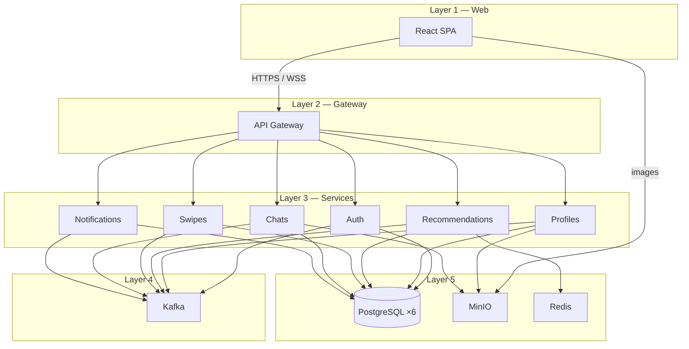

# Commit

Dating platform built as a **microservices monorepo** (diploma project): profiles, embedding-based recommendations, swipes/matches, real-time chats, and notifications.

```
Browser (React) → API Gateway (Go) → domain services → Kafka / PostgreSQL / MinIO / Redis
```

## Features

- **Auth** — register / login, JWT (RS256), account deletion
- **Profiles** — profile data, tags, image upload (MinIO)
- **Discover** — recommendation feed with filters; optional LLM compatibility text (Ollama)
- **Swipes & matches** — likes, mutual matches (“commits”)
- **Chats** — 1:1 messaging (REST + WebSocket), chat images
- **Notifications** — real-time WebSocket push fed by Kafka events

## Architecture

| Layer | Components |
| ----- | ---------- |
| **1 — Web** | React SPA (`frontend/react-app`) |
| **2 — Gateway** | Go / Chi API gateway + OpenAPI docs |
| **3 — Services** | Auth, Profiles, Recommendations, Swipes, Chats, Notifications |
| **4 — Events** | Apache Kafka |
| **5 — Data** | 6× PostgreSQL, MinIO, Redis (+ Ollama for compatibility text) |



**Protocols**

| From → To | Protocol |
| --------- | -------- |
| Browser → Gateway | HTTP / WebSocket (`/api/v1`) |
| Gateway → Auth, Chats, Notifications | HTTP (+ `X-User-Id` after JWT) |
| Gateway → Profiles, Recommendations, Swipes | gRPC |
| Services ↔ Kafka | domain events |
| Browser → MinIO | HTTPS GET (images) |

More detail: [`backend/C4_DIAGRAMS.md`](backend/C4_DIAGRAMS.md).

### Kafka topics

| Topic | Typical producers → consumers |
| ----- | ----------------------------- |
| `user.created` / `user.deleted` | Auth → Profiles, Recommendations |
| `profile.updated` | Profiles → Recommendations |
| `swipe.created` | Swipes → Recommendations, Notifications |
| `match.created` | Swipes → Chats, Notifications |
| `chat.message` / `chat.deleted` | Chats → Notifications |

## Tech stack

| Area | Technology |
| ---- | ---------- |
| Frontend | React 19, Vite, TypeScript, TanStack Query, Zustand, Zod |
| Gateway | Go, Chi |
| Auth / Chats / Notifications | Python, FastAPI |
| Profiles / Swipes | Go, gRPC |
| Recommendations | Python, gRPC, sentence-transformers, pgvector |
| Infra | Docker Compose, Kafka, PostgreSQL 16, MinIO, Redis 7, Ollama |

## Repository layout

```
commit/
├── frontend/
│   └── react-app/          # React SPA (Vite)
├── backend/
│   ├── docker-compose.yml  # Full stack
│   ├── api-gateway-openapi/# OpenAPI + Swagger UI image
│   ├── Commit.postman_collection.json
│   ├── C4_DIAGRAMS.md
│   ├── kafka-topics-init.sh
│   └── services/
│       ├── api-gateway/
│       ├── authentications/
│       ├── profiles/
│       ├── recommendation/
│       ├── swipes/
│       ├── chats/
│       └── notifications/
└── README.md
```

## Prerequisites

- [Docker](https://docs.docker.com/get-docker/) + Docker Compose
- For local frontend only: **Node.js 22+** and npm
- ~several GB disk/RAM (Ollama model pull + embeddings on first recommendation use)

## Quick start (Docker)

From the backend folder:

```bash
cd backend
docker compose up --build
```

First start may take a while (images, Kafka topics init, Ollama `qwen2.5:3b` pull).

### URLs

| URL | Description |
| --- | ----------- |
| http://localhost:3000 | Web app |
| http://localhost:18000 | API gateway (`/api/v1`, `/health`) |
| http://localhost:8088 | Swagger UI (OpenAPI) |
| http://localhost:9000 | MinIO |
| http://localhost:11434 | Ollama |

### Host ports

On Windows, compose maps gateway/auth to **18000+** because Hyper-V often reserves `7916–8015` (see comment in `docker-compose.yml`).

| Host port | Service |
| --------- | ------- |
| `3000` | Frontend (nginx) |
| `18000` | API gateway |
| `8088` | API docs |
| `18001` | Auth |
| `18002` | Profiles (container HTTP; gRPC `50051` internal) |
| `50052` | Recommendations (gRPC) |
| `50053` | Swipes (gRPC) |
| `18005` | Chats |
| `18006` | Notifications |
| `5432`–`5437` | PostgreSQL (per service) |
| `6379` | Redis |
| `9092` | Kafka |
| `9000` | MinIO |
| `11434` | Ollama |

### Environment

Each service loads a `.env` via Compose (`backend/services/<name>/.env`). Defaults target the Docker network (service hostnames like `ms-auth`, `kafka`, `minio`).

- Example for recommendations: [`backend/services/recommendation/.env.example`](backend/services/recommendation/.env.example)
- JWT keys live under service `keys/` (gateway uses the public key; auth issues tokens)

> Compose credentials are for **local development only** — change them before any shared or production deployment.

## Frontend (local Vite)

With the backend stack already running (at least the API gateway on `:18000`):

```bash
cd frontend/react-app
npm install
npm run dev
```

- Dev server: http://localhost:3000  
- Vite proxies `/api` → `http://localhost:18000`  
- Optional env: `VITE_MINIO_URL=http://localhost:9000` for image URLs

```bash
npm run build    # production bundle
npm run preview  # preview dist/
```

### App routes

| Path | Page |
| ---- | ---- |
| `/poster` | Landing |
| `/profile` | Own profile |
| `/discover` | Recommendation feed |
| `/commits` | Matches |
| `/messages` | Chats |
| `/user/:userId` | Other user profile |

## API

- **OpenAPI:** [`backend/api-gateway-openapi/openapi.yaml`](backend/api-gateway-openapi/openapi.yaml)
- **Swagger UI:** http://localhost:8088 (Compose service `api-gateway-docs`)
- **Postman:** [`backend/Commit.postman_collection.json`](backend/Commit.postman_collection.json)

Protected routes: `Authorization: Bearer <access_token>`.  
WebSockets (chats / notifications): `?token=<JWT>` (browsers cannot set `Authorization` on the handshake).

Main path groups under `/api/v1`:

- `/auth/*` — register, login, refresh, delete account  
- `/profiles/*` — profile CRUD, images, tags  
- `/recommendations`, `/recommendations/filters`, `/recommendations/compatibility`  
- `/swipes`, `/matches`  
- `/chats/*` (+ `/{peer}/ws`)  
- `/notifications/ws`

Chats WebSocket behaviour: [`backend/services/chats/README.md`](backend/services/chats/README.md).

## Documentation

| Doc | Description |
| --- | ----------- |
| [`backend/C4_DIAGRAMS.md`](backend/C4_DIAGRAMS.md) | C4 / 5-tier architecture diagrams (PlantUML) |
| [`backend/services/chats/README.md`](backend/services/chats/README.md) | Chat REST + WebSocket frames |
| [`backend/api-gateway-openapi/openapi.yaml`](backend/api-gateway-openapi/openapi.yaml) | Public HTTP API contract |

## Development notes

- **Database-per-service** — each domain service owns its Postgres instance.
- **No direct browser → microservice calls** — all API traffic goes through the gateway (images may load from MinIO).
- **Async coupling** — services communicate domain changes via Kafka, not sync HTTP between domains.
- **Recommendations** — embeddings + filters in Redis/Postgres; Ollama is used only for compatibility text, not for ranking.

## License

Private diploma / coursework project — no open-source license file is included. Ask the author before reuse.
